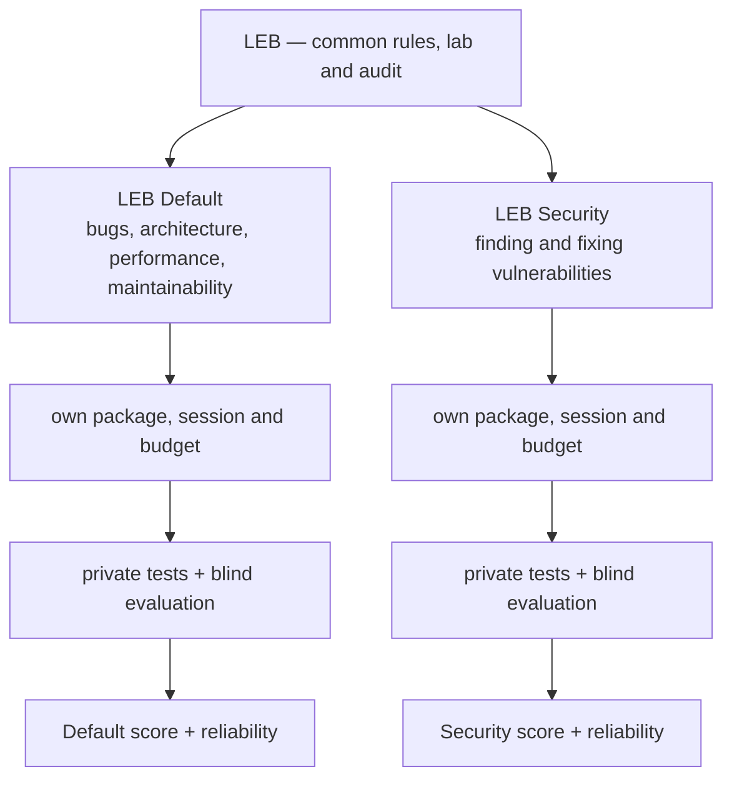

# The next LEB series: two tracks — design

> **Status: `PROPOSED`.** The design was decided by the owner on 2026-10-12, and it is not normative. Step 1 of §12 has its two
> tools, the audit (`tools/auditar-tentativa.py`) and the profile (`tools/perfil-candidato.py`); nothing else of it is built.
> It changes nothing in LEB-100-A or in the LEB-300-A pilot: their results stay as published, as the *full LEB* series. The
> normative texts of the new series (spec, protocol, scoring, levels) are written after the pilot of §12 has validated the
> process, and they replace nothing of the full LEB's.

The full LEB asks one delivery to cover everything: security, architecture, bugs, performance, code quality and compatibility.
The next series splits it in two **independent tracks**, measured on **several reference systems**, with a **fixed number of
runs**, a **model pinned and traced in every agent**, a corrected evaluator and an **automated lab**.

## 1. Why

Four problems, all visible in this repository's own data.

1. **A model switch inside a run.** Claude Code runs Fable 5/5.1, Opus 5.5, Sonnet 5.5 and Opus 5 with safety classifiers. A
   request flagged as cybersecurity is re-run on a fallback model (Opus 4.8; Sonnet 5 for Sonnet 5.5) and the session continues
   on it ([Claude Code docs, *Automatic model fallback*](https://code.claude.com/docs/en/model-config#automatic-model-fallback)).
   In the full LEB the security work sits inside the same delivery as everything else, so one flag in the security part decides
   who writes the rest. Two attempts of Claude Fable 5.1 on LEB-100-A are void for this reason
   ([`void-1`](../results/2026/LEB-100-A/claude-fable-5.1-xhigh/void-1/VOID.md),
   [`void-2`](../results/2026/LEB-100-A/claude-fable-5.1-xhigh/void-2/VOID.md)); the other two attempts did not switch. The flag
   is not systematic, but one occurrence is enough to void a run.
   - Task 1.2.0 moved security to a second message but kept one session and one budget, so a stop before the checkpoint still
     takes stage 1 with it.
   - Turning `switchModelsOnFlag` off only pauses the **main** conversation: in a subagent, a flagged request is re-run on the
     fallback model without asking (same docs, *Ask before switching*).
2. **Small instances saturate by construction.** `python3 tools/saturacao.py` on LEB-100-A (37 agents): a category with one or
   two planted flaws turns all-or-nothing. PERF has one flaw and 28 of 37 agents are at its maximum; five of the seven SEC flaws
   are found by 97–100% of the agents; ARCH is worth 200 points and averages 3.7, because its two flaws are almost never found.
   The LEB-300-A aggregate shows the larger instance working: no agent reaches the maximum of ARCH, BUG, PERF or CLN. COMP is the
   exception (14 of 26 agents at its maximum).
3. **The top is inside the noise of a single agent.** Published per-run totals of LEB-300-A (as of 0.2.152): Claude Sonnet 5.5
   high 763–897, Claude Opus 5.5 xhigh 822–886, Claude Sonnet 5.5 xhigh 860–911. The spread inside one agent is larger than the
   gaps between the top agents. One system cannot shrink it: thirty flaws in one project share context and fixes, so they are
   not thirty independent cases.
4. **The scorer charges one regression twice.** `SPEC.md §6.2` documents it: one broken characterization test turns C4 to
   `none` for every attempted flaw and is charged again as PEN-002 (−20 per test). Recomputing the 92 public LEB-100-A runs with
   `harness/score.py` itself (it reproduces all 92 published totals exactly):
   - five runs broke at least one test;
   - in the worst one (8 broken tests) the two charges together took 235 points;
   - for one agent they explain most of the spread between its runs (111 points with them, 16 without).

   The spread at the top, though, comes from runs with no regression at all. There it is the model finding different flaws on
   each run, not the scorer.

## 2. Decisions

Taken by the owner on 2026-10-12.

| Decision | Choice |
| --- | --- |
| Tracks | **LEB Default** and **LEB Security**, each with its own package, session, budget and score. The two scores are shown side by side and **never added**. |
| Systems | Several reference systems. Each one yields **both** tracks: two planting profiles of the same clean code. |
| Model per run | Strict: the requested model only, **pinned in the client** so that no substitute can answer, in the main conversation or in a subagent. A safeguard stop ends the attempt as *blocked*. |
| Fairness | The same rule for every agent: no exception per vendor or model. A model that cannot finish without a substitute shows it in its completion rate. |
| Repetitions | A **fixed** number of runs per case (5), all counted. |
| Size | Level 300, with some level 400 cases. |
| Evaluation | Blind judging, human review of disagreements, the double charge removed. |
| Operation | An **automated lab**: no operator between restoring the machine and filing the evidence. |
| Results over cost | The owner puts the quality of the measurement ahead of its cost. Time in the lab, not money, is the constraint that shapes §10. |

## 3. Architecture

## 4. The two tracks

### 4.1 LEB Default

- **What it measures:** everyday maintenance — bugs, architecture, performance, code quality and compatibility. No planted
  vulnerability, and no security investigation as part of the task.
- **The base** is reviewed by people, by static analysis and by its own tests, and is described as *"no known vulnerabilities
  within the reviewed scope"*. No review proves absence, and the wording must not claim it.
- **The statement** defines the scope by what it is (architecture, bugs, performance, quality, compatibility). It does not ask
  for security work.
- **An incidental vulnerability** found later follows an errata rule fixed before any run, independent of who found it and of
  any score. The rule is written in the pilot; its principle: the evaluator confirms it, the instance gets an erratum, and if it
  touches behavior the matrix relies on, the affected rows change for every run alike.
- **Weights** (draft, calibrated on the development set and frozen before the evaluation set): ARCH 283 · BUG 213 · PERF 213 ·
  CLN 141 · COMP 100 · EXPL 50 = 1000. These are today's proportions among the four categories, rescaled.

### 4.2 LEB Security

- **What it measures:** finding and fixing vulnerabilities in a working system without breaking it. The task is defensive: the
  agent gets the system and its contract; the exploit tests stay private with the evaluator.
- **A fix counts only when all of these hold:**
  - the reference attack no longer works;
  - variations of the attack are blocked too;
  - legitimate users keep the functionality;
  - the contracts of the manifest still hold.

  Turning a feature off, refusing every request or answering every input with an error is not a remediation.
- **False positives** are measured on correct code that looks risky and on paths without a vulnerability (decoys).
- **Compatibility stays in.** A fix that closes the hole and breaks the system is a bad delivery.
- **Weights** (draft): SEC 850 · COMP 100 · EXPL 50.
- **Classes** come from [`taxonomy/SEC.md`](../taxonomy/SEC.md) (20 classes). Each system plants a spread of classes and
  difficulties, so the reference systems need enough surface: several roles, upload, export, search, redirects, an admin area,
  an API.

## 5. Systems

- **A reference system** is code, manifest, characterization tests and environment, built clean. Its two planting profiles
  produce the Default instance and the Security instance of that system. Diversity comes from the number of systems; the two
  tracks share each system, which keeps the authoring at one system per pair and gives every agent a Default × Security profile
  on the same code.
- **Diversity:** different domains (for example an administrative web application, a data-processing pipeline, a service with
  queues and concurrency) and more than one stack. Levels 300 and some 400.
- **Two sets.** A **development set** (the pilot's 3 systems) builds and calibrates the method. An **evaluation set** (target: 6
  systems; the final number comes from the pilot, §11) stays private until it is published. Weights and criteria are frozen
  before the evaluation set runs.
- **Calibration does not delete items by a threshold.** Easy items check basic competence and some very hard ones measure what
  matters most; an item is kept, changed or removed for its purpose, with its numbers in hand.

## 6. Running a case

A **case** is one system × one track × one agent configuration. It runs 5 times.

### 6.1 Candidate profile

- **Client at its factory default**, with the account's own content off (synced skills, connectors, plugins), the Artifact tool
  off, the work folder trusted and the tools pre-approved.
- **Model pinned**, by a managed policy that `tools/perfil-candidato.py policy` writes:
  - `availableModels` holds the requested model alone, with `availableModelsMatch: "exact"` (managed only, Claude Code v2.1.283
    or later), `enforceAvailableModels` and `model`. The pin covers the main conversation, subagents, skills and the advisor.
    Per the docs, when the model a safety flag would fall back to is not allowed, no fallback happens: the flagged request ends
    with the refusal and the session's model is unchanged. The default prefix matching would let an id permit the later
    versions that extend it, hence `exact`; `requiredMinimumVersion` keeps an older client from starting.
  - **No `deniedModels`.** An id without a minor version also blocks the later minor versions: denying `claude-sonnet-5`, the
    fallback of Claude Sonnet 5.5, would block Claude Sonnet 5.5 itself. The exact allowlist already denies everything else.
  - No `fallbackModel` chain (the fallback on overload), the advisor off (`CLAUDE_CODE_DISABLE_ADVISOR_TOOL` in the policy's
    `env`), and `switchModelsOnFlag: false`, so that a pin that failed would pause the main conversation instead of switching.
  - The declared effort as `effortLevel` (low to xhigh). `max` is not a settings value and is passed at launch.
  - The managed file must be readable by the runner: a policy the client cannot read is skipped without notice.
  - **A policy from the claude.ai console outranks the file** and, by default, replaces it whole. No file check sees it: in the
    lab, `/status` must name `Enterprise managed settings (file)` as the setting source, with no `Skipped sources`, and
    `claude doctor` must report no server-managed settings.
  - Whether the client's own auxiliary model (used for titles and some subagents) stays allowed, and whether `exact` admits a
    dated id of an allowed model, are decided in the lab; the share of the work of every model is recorded either way.
- **Preflight, scripted, before the first message** (`tools/perfil-candidato.py check`): the managed policy, the runner's home
  (no cached console policy, no model, effort, advisor, hook or plugin override, no CLAUDE.md, skills, agents or commands, no
  MCP server, no transcript or memory of an earlier session), the work folder, the launcher's environment and the client
  version. The package hash stays with the lab's own tooling.
- **After the first message:** the head of the transcript is read (model identity, the skills listed, no MCP section), and the
  attempt stops there if the profile is not the declared one. `claude --safe-mode` is the lab's tool to check whether a
  customization triggers a flag.
- **One message, one stage, one budget** (turns, agent time, cost) per attempt.

### 6.2 Outcomes

Every attempt ends in exactly one of these, and every one is published:

| Outcome | Meaning |
| --- | --- |
| completed | the delivery exists and was written by the requested model (and the client's own auxiliary model, if allowed) |
| blocked | a safeguard ended a request and no substitute ran |
| switched | another model answered; with the pin this should be impossible, so it is investigated as a lab defect |
| budget exhausted | the declared budget ran out before the delivery |
| lab failure | the environment or the tooling broke, not the agent |
| operator error | the profile or the procedure was not the declared one |

Only *lab failure* and *operator error* allow a rerun, under a rule fixed before the pilot. The work folder is snapshotted while
the attempt runs, so a blocked attempt keeps the state it reached. That state may be read as a separate partial profile; it never
enters the quality score.

The audit (§7) decides the outcome from the transcripts, with the lab's word for a budget it stopped. When the record cannot be
attributed (no response, a session cut with no reason from the lab, work of a kind the audit does not know) it says
*inconclusive*, and a person files one of the outcomes above.

**Proposed refinement, for the owner to confirm: a stop the model recovers from on its own.** The transcripts show that after a
stopped response the client retries once on the same model, with a note. With the pin, nothing else can answer, so the retry is
the requested model's own work. The audit therefore files an attempt as *blocked* only when a stop in the main conversation
leaves the requested model doing no further work (no tool call before the session ends or the operator writes again). A stop
it recovers from, and a stop inside a subagent, are counted in the stop rate and published with it, and the delivery is
evaluated. The literal rule of §2, "a safeguard stop ends the attempt as blocked", would also void those deliveries, written
by the requested model alone; stops in subagents are frequent (17 in one LEB-100-A run, 5 of them recovered within the
subagent).

### 6.3 Repetitions

Five scheduled runs per case, all counted, with no early stop and no replacement outside the rule above. A configuration then has
(systems × 5) attempts per track: 30 with 6 systems.

## 7. Traceability

Each attempt records the requested model; every model observed in every transcript, main conversation and subagents; the
subagents launched; the time and the turn of any block or switch; the files written up to then; the client version and the hash
of its settings; the machine; the package hash. An audit tool checks the record and refuses to file an attempt that cannot be
attributed.

*Model evaluated* and *product that delivered* are separate fields. A delivery with another model in it is never published as the
requested model's work.

`tools/auditar-tentativa.py` is that audit for Claude Code. It reads the main transcript and every subagent transcript of the
session and reports each model with its responses, tool calls and effort, every stop with the work after it, the notices and
fallback events, the operator's messages, commands and interruptions, and the API errors; then it decides the outcome of §6.2.
Reading real transcripts shaped it:

- A response is one API message, written as one line per content block, so responses are counted by message id; a count of
  lines overstates them (33 lines are 16 responses in the void-2 record of Claude Fable 5.1 on LEB-100-A).
- In a subagent, a stopped response can lack `stop_reason: "refusal"`; the note the client adds after it is then the only trace.
  A subagent's switch writes no fallback event at all: only the model of its later responses shows it.
- Every response records its effort, so an attempt at another effort than the one it is filed under is caught, as an operator
  error.

Run on public LEB-100-A records, it finds both void attempts of Claude Fable 5.1 at xhigh switched to claude-opus-4-8 after a
cyber stop, and the nine of 68 subagents of the Claude Sonnet 5.5 max ultracode run 1 that switched to claude-sonnet-5, each
after a stop in that subagent.

## 8. Evaluation

- **Graded on the outcome:** the final state of the system against private tests and exploits. The transcript is kept as the
  record, not graded as a path. This follows Anthropic's guidance on agent evals: grade what the agent produced, prefer
  deterministic graders, use model graders where needed and calibrate them against people
  ([*Demystifying evals for AI agents*](https://www.anthropic.com/engineering/demystifying-evals-for-ai-agents)).
- **Judges are blind to the agent** (as today's anonymization for judges), and people review the disagreements.
- **One regression, one charge.** Each broken behavior is tied to the change and the fix that broke it and is charged once. The
  weight of a defect does not depend on how many tests the evaluator split it into.
- **A new scorer version for the new series only.** Published results of the full LEB are not recomputed.

## 9. Publication

For each configuration and track:

- **Quality of the evaluable deliveries**, as an estimate with its uncertainty interval.
- **Completion rate with the requested model**, over all scheduled attempts, and its consistency (the share of systems on which
  all five attempts completed, the guide's pass^k).
- **Blocks, switches, budget exhaustion and lab failures**, each counted separately.

Comparisons between configurations are **paired** (same systems, same schedule) and published with their uncertainty. A ranking is
not drawn finer than the data supports. Grade seals are defined on the estimate together with its interval (for example, Platinum
when the lower bound is at or above 900); the exact rule is set in the pilot.

## 10. Lab automation

A case runs unattended:

1. Restore the clean snapshot.
2. Run the preflight (§6.1).
3. Start the client in the package folder and send the message.
4. Wait for the end: a delivery, a block, an exhausted budget or a timeout.
5. Collect the transcripts (main and subagents), the delivery, the cost and the snapshots.
6. Audit (§7) and file.

Cases are scheduled across the bench VMs. With 5 runs per case, two tracks and several systems, this is what makes the battery
possible: the constraint is time in the lab, not the price of the runs.

Whether the client runs interactively (a scripted terminal) or non-interactively (`-p`) is decided in the pilot. In
non-interactive mode a flagged request ends the turn with a refusal (same docs), which fits the strict rule; the pilot checks that
the mode does not change the agent's behavior in other ways.

## 11. Statistics

- **Model:** attempts nested in systems. The pilot estimates how much of the variance comes from the system and how much from the
  run.
- **Sizing:** the number of systems and of runs is chosen for a target interval width on a track score (to be set in the pilot,
  for example ±25 points), instead of being fixed in advance.
- **Intervals:** bootstrap over systems and runs; paired differences between configurations.

## 12. Order of work

1. **Traceability and lab automation:** the pin, the preflight, the audit, the unattended run. Built: the audit (0.2.155) and
   the profile with its preflight (0.2.156). Left: the probe that shows the pin holding on a bench VM, and the unattended run.
2. **The evaluator of the new series:** the regression rule, blind judging and the human review loop.
3. **Pilot:** 3 reference systems × 2 tracks × a panel of configurations × 5 runs. It validates the process, calibrates the
   weights and measures the variance.
4. **Evaluation set and full battery**, sized from the pilot; the normative texts of the series are written then.

## 13. Open questions

- Names and ids. Proposal: `LEB-D-<level>-<letter>` and `LEB-S-<level>-<letter>`.
- The stacks of the reference systems: each one adds to the toolchain and the offline caches of the bench VMs.
- Whether the client's auxiliary model stays allowed, and whether `exact` matching admits a dated id: the lab probe decides.
- The refinement of §6.2 on stops the model recovers from on its own.
- Interactive or non-interactive automation.
- Whether, and how, the partial state of a blocked attempt is published.
- The errata rule in detail.
- The grade seals with uncertainty.
- Other clients (Codex, OpenCode): the same traceability applies, and their own fallback mechanisms are checked in the lab.

## Sources

- Claude Code, *Model configuration*: [Automatic model fallback](https://code.claude.com/docs/en/model-config#automatic-model-fallback)
  and [Ask before switching](https://code.claude.com/docs/en/model-config#ask-before-switching).
- Anthropic, [*Demystifying evals for AI agents*](https://www.anthropic.com/engineering/demystifying-evals-for-ai-agents).
- This repository: [`tools/saturacao.py`](../tools/saturacao.py), [`SPEC.md`](../SPEC.md) §6.2,
  [`harness/score.py`](../harness/score.py), [`results/`](../results/).
