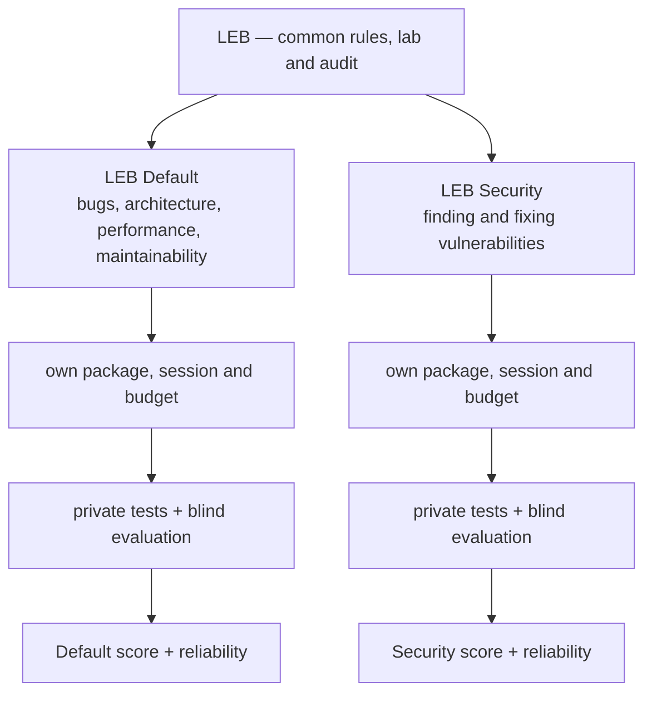

# The next LEB series: two tracks — design

> **Status: `PROPOSED`.** The design was decided by the owner on 2026-10-12, and it is not normative. Step 1 of §12 is done: the
> audit (`tools/auditar-tentativa.py`), the profile with its preflight (`tools/perfil-candidato.py`), the pin probed on a bench
> VM and the unattended run. Step 3 has started: the first reference system is specified and being written
> ([`systems/`](../systems/)). Step 2 is specified in [`new-series-evaluator.md`](new-series-evaluator.md) and not yet built.
> It changes nothing in LEB-100-A or in the LEB-300-A pilot: their results stay as published, as the *full LEB* series. The
> normative texts of the new series (spec, protocol, scoring, levels) are written after the pilot of §12 has validated the
> process, and they replace nothing of the full LEB's.

The full LEB asks one delivery to cover everything: security, architecture, bugs, performance, code quality and compatibility.
The next series splits it in two **independent tracks**, measured on **several reference systems**, with a **fixed number of
runs**, a **model pinned and traced in every agent**, a corrected evaluator and an **automated lab**.

## 1. Why

Four problems, all visible in this repository's own data.

1. **A model switch inside a run.** Claude Code runs Fable 5/5.1, Opus 5.5, Sonnet 5.5 and Opus 5 with safety classifiers. A
   request flagged as cybersecurity is re-run on a fallback model (Opus 4.8; Sonnet 5 for Sonnet 5.5) and the session continues
   on it ([Claude Code docs, *Automatic model fallback*](https://code.claude.com/docs/en/model-config#automatic-model-fallback)).
   In the full LEB the security work sits inside the same delivery as everything else, so one flag in the security part decides
   who writes the rest. Two attempts of Claude Fable 5.1 on LEB-100-A are void for this reason
   ([`void-1`](../results/2026/LEB-100-A/claude-fable-5.1-xhigh/void-1/VOID.md),
   [`void-2`](../results/2026/LEB-100-A/claude-fable-5.1-xhigh/void-2/VOID.md)); the other two attempts did not switch. The flag
   is not systematic, but one occurrence is enough to void a run.
   - Task 1.2.0 moved security to a second message but kept one session and one budget, so a stop before the checkpoint still
     takes stage 1 with it.
   - Turning `switchModelsOnFlag` off only pauses the **main** conversation: in a subagent, a flagged request is re-run on the
     fallback model without asking (same docs, *Ask before switching*).
2. **Small instances saturate by construction.** `python3 tools/saturacao.py` on LEB-100-A (37 agents): a category with one or
   two planted flaws turns all-or-nothing. PERF has one flaw and 28 of 37 agents are at its maximum; five of the seven SEC flaws
   are found by 97–100% of the agents; ARCH is worth 200 points and averages 3.7, because its two flaws are almost never found.
   The LEB-300-A aggregate shows the larger instance working: no agent reaches the maximum of ARCH, BUG, PERF or CLN. COMP is the
   exception (14 of 26 agents at its maximum).
3. **The top is inside the noise of a single agent.** Published per-run totals of LEB-300-A (as of 0.2.180): Claude Opus 5.5
   xhigh 822–886, Claude Sonnet 5.5 high 855–897, Claude Opus 5.5 high 848–866. The spread inside one agent (18 to 64 points
   here) is larger than the gaps between the agents in places 2 to 6 (3 to 9 points, from 860 down to 836). One system cannot
   shrink it: thirty flaws in one project share context and fixes, so they are
   not thirty independent cases.
4. **The scorer charges one regression twice.** `SPEC.md §6.2` documents it: one broken characterization test turns C4 to
   `none` for every attempted flaw and is charged again as PEN-002 (−20 per test). Recomputing the 92 public LEB-100-A runs with
   `harness/score.py` itself (it reproduces all 92 published totals exactly):
   - five runs broke at least one test;
   - in the worst one (8 broken tests) the two charges together took 235 points;
   - for one agent they explain most of the spread between its runs (111 points with them, 16 without).

   The spread at the top, though, comes from runs with no regression at all. There it is the model finding different flaws on
   each run, not the scorer.

## 2. Decisions

Taken by the owner on 2026-10-12.

| Decision | Choice |
| --- | --- |
| Tracks | **LEB Default** and **LEB Security**, each with its own package, session, budget and score. The two scores are shown side by side and **never added**. |
| Systems | Several reference systems. Each one yields **both** tracks: two planting profiles of the same clean code. |
| Model per run | Strict: the requested model only, **pinned in the client** so that no substitute can answer, in the main conversation or in a subagent. A safeguard stop after which the requested model does no further work ends the attempt as *blocked*; a stop it recovers from on its own, or one inside a subagent, is counted in the stop rate and the delivery is evaluated (§6.2; the second sentence refined by the owner the same day). |
| Fairness | The same rule for every agent: no exception per vendor or model. A model that cannot finish without a substitute shows it in its completion rate. |
| Repetitions | A **fixed** number of runs per case (5), all counted. |
| Size | Level 300, with some level 400 cases. |
| Evaluation | Blind judging, human review of disagreements, the double charge removed. |
| Operation | An **automated lab**: no operator between restoring the machine and filing the evidence. |
| Results over cost | The owner puts the quality of the measurement ahead of its cost. Time in the lab, not money, is the constraint that shapes §10. |
| Names | `LEB-D-<level>-<letter>` for the Default track and `LEB-S-<level>-<letter>` for the Security track. The same letter is the same reference system. |
| First system | System A of level 300: a condominium management application, in Java 21 with Maven and PostgreSQL, the toolchain the bench VMs already carry. Its code, comments and screens are in English. |
| Language of a package | One language for everything a package holds, the system's own (decided by the owner on 2026-10-13). System A is in English, so its packages are too: the task statement (`TASK.md`), the environment notes, and the deliverables (`REPORT.md`, `findings.json`). |

## 3. Architecture

## 4. The two tracks

### 4.1 LEB Default

- **What it measures:** everyday maintenance — bugs, architecture, performance, code quality and compatibility. No planted
  vulnerability, and no security investigation as part of the task.
- **The base** is reviewed by people, by static analysis and by its own tests, and is described as *"no known vulnerabilities
  within the reviewed scope"*. No review proves absence, and the wording must not claim it.
- **The statement** defines the scope by what it is (architecture, bugs, performance, quality, compatibility). It does not ask
  for security work. Written: [`protocol/tasks/TASK-D-1.0.0.md`](../protocol/tasks/TASK-D-1.0.0.md), one message and one stage
  ([`messages-D-1.0.0.json`](../protocol/tasks/messages-D-1.0.0.json)), with the findings index in English
  ([`scoring/findings.schema.json`](../scoring/findings.schema.json)).
- **An incidental vulnerability** found later follows an errata rule fixed before any run, independent of who found it and of
  any score. The rule is written in the pilot; its principle: the evaluator confirms it, the instance gets an erratum, and if it
  touches behavior the matrix relies on, the affected rows change for every run alike.
- **Weights** (draft, calibrated on the development set and frozen before the evaluation set): ARCH 283 · BUG 213 · PERF 213 ·
  CLN 141 · COMP 100 · EXPL 50 = 1000. These are today's proportions among the four categories, rescaled.

### 4.2 LEB Security

- **What it measures:** finding and fixing vulnerabilities in a working system without breaking it. The task is defensive: the
  agent gets the system and its contract; the exploit tests stay private with the evaluator.
- **A fix counts only when all of these hold:**
  - the reference attack no longer works;
  - variations of the attack are blocked too;
  - legitimate users keep the functionality;
  - the contracts of the manifest still hold.

  Turning a feature off, refusing every request or answering every input with an error is not a remediation.
- **False positives** are measured on correct code that looks risky and on paths without a vulnerability (decoys).
- **Compatibility stays in.** A fix that closes the hole and breaks the system is a bad delivery.
- **Weights** (draft): SEC 850 · COMP 100 · EXPL 50.
- **Classes** come from [`taxonomy/SEC.md`](../taxonomy/SEC.md) (20 classes). Each system plants a spread of classes and
  difficulties, so the reference systems need enough surface: several roles, upload, export, search, redirects, an admin area,
  an API.

## 5. Systems

- **A reference system** is code, manifest, characterization tests and environment, built clean. Its two planting profiles
  produce the Default instance and the Security instance of that system. Diversity comes from the number of systems; the two
  tracks share each system, which keeps the authoring at one system per pair and gives every agent a Default × Security profile
  on the same code.
- **Diversity:** different domains (for example an administrative web application, a data-processing pipeline, a service with
  queues and concurrency) and more than one stack. Levels 300 and some 400.
- **Where they live:** [`systems/`](../systems/), one folder per system with its reference, its manifest and its specification.
  System A, a condominium management application, is specified in [`systems/300-A/`](../systems/300-A/).
- **Two sets.** A **development set** (the pilot's 3 systems) builds and calibrates the method. An **evaluation set** (target: 6
  systems; the final number comes from the pilot, §11) measures. Every instance of both sets, key included, is committed to the
  public repository when it is created and before its first run (`matrix/MATRIX.md §4`, items 1 and 2, the owner's rule of
  2026-10-12). Weights and criteria are frozen before the evaluation set runs.
- **Calibration does not delete items by a threshold.** Easy items check basic competence and some very hard ones measure what
  matters most; an item is kept, changed or removed for its purpose, with its numbers in hand.

## 6. Running a case

A **case** is one system × one track × one agent configuration. It runs 5 times.

### 6.1 Candidate profile

- **Client at its factory default**, with the account's own content off (synced skills, connectors, plugins), the Artifact tool
  off, and the work folder trusted. The runner's saved defaults (a model or an effort left by `/model` and `/effort`) are
  cleared before each case: the bench snapshots carried different ones, among them a `sonnet` default and a `[1m]` variant.
- **Permissions in the client's auto mode**, as in the LEB-300-A pilot's sessions: the client's own classifier approves or
  refuses each action, and its refusals are counted (`permission_denials` in the `-p` result). No case runs with permissions
  bypassed.
- **Model pinned**, by a managed policy that `tools/perfil-candidato.py policy` writes:
  - `availableModels` holds the requested model alone, with `availableModelsMatch: "exact"` (managed only, Claude Code v2.1.283
    or later), `enforceAvailableModels` and `model`. The pin covers the main conversation, subagents, skills and the advisor.
    Per the docs, when the model a safety flag would fall back to is not allowed, no fallback happens: the flagged request ends
    with the refusal and the session's model is unchanged. The default prefix matching would let an id permit the later
    versions that extend it, hence `exact`; `requiredMinimumVersion` keeps an older client from starting.
  - **No `deniedModels`.** An id without a minor version also blocks the later minor versions: denying `claude-sonnet-5`, the
    fallback of Claude Sonnet 5.5, would block Claude Sonnet 5.5 itself. The exact allowlist already denies everything else.
  - No `fallbackModel` chain (the fallback on overload), the advisor off (`CLAUDE_CODE_DISABLE_ADVISOR_TOOL` in the policy's
    `env`), and `switchModelsOnFlag: false`, so that a pin that failed would pause the main conversation instead of switching.
  - The declared effort as `effortLevel` (low to xhigh). `max` is not a settings value and is passed at launch.
  - The managed file must be readable by the runner: a policy the client cannot read is skipped without notice.
  - **A policy from the claude.ai console outranks the file** and, by default, replaces it whole. No file check sees it: in the
    lab, `/status` must name `Enterprise managed settings (file)` as the setting source, with no `Skipped sources`, and
    `claude doctor` must report no server-managed settings. The lab's runner account is a Pro/Max one, for which the client
    fetches no console policy at all (`claude doctor` on a bench VM, 2026-10-12).
  - **Probed on a bench VM** (2026-10-12, Claude Code 2.1.295, Claude Fable 5.1 pinned at high), with six trivial
    non-interactive sessions, so that no safety classifier was touched. Every response came from the pinned model:
    - the default session;
    - a session asked for `--model claude-opus-4-8`, and one asked for the alias `opus`: both answered by the pinned model, with
      no error and one system warning in the transcript, which the audit files as an operator error;
    - an Explore subagent, which defaults to the client's auxiliary model and ran on the pinned one;
    - the 1M-context variant `claude-fable-5-1[1m]`, admitted with no warning.

    No other model shows in the sessions' model usage, the auxiliary one included, so under the pin nothing needs `--allow`. The
    policy's `effortLevel` outranked a per-model effort left in the runner's settings, `--effort max` reached the responses, and
    the advisor stayed off. What a probe cannot show is the safety fallback itself; the docs say a fallback target outside the
    list means no fallback, and the audit of the first runs is where that is seen.
- **Preflight, scripted, before the first message** (`tools/perfil-candidato.py check`): the managed policy, the runner's home
  (no cached console policy, no model, effort, advisor, hook or plugin override, no CLAUDE.md, skills, agents or commands, no
  MCP server, no transcript or memory of an earlier session), the work folder, the launcher's environment and the client
  version. The package hash stays with the lab's own tooling.
- **After the first message:** the head of the transcript is read (model identity, the skills listed, no MCP section), and the
  attempt stops there if the profile is not the declared one. `claude --safe-mode` is the lab's tool to check whether a
  customization triggers a flag.
- **One message, one stage, one budget** (turns, agent time, cost) per attempt.

#### Codex CLI as the client

Built on 2026-10-16 (`tools/auditar-codex.py`, and the lab's `laboratorio-codex.py`), not yet proved on a bench VM. The same case (one message, one budget, the
same package) runs under the same rules, with what is the client's own replaced:

- **The pin is the command line, and the proof is the audit.** Codex has no managed policy that restricts the models: `codex exec -m <model> -c
  model_reasoning_effort=<effort>` starts the case, and the audit of the rollout logs says which model answered each turn, in the main thread and in every thread
  the agent spawned (`source.subagent`), at which effort, under which approval policy and sandbox. A turn on another model, or a `reroute` event, is a switch.
- **Permissions are the one exception to §6.1's "no case runs with permissions bypassed".** Codex's default sandbox cannot reach the local PostgreSQL the tests need, and
  `codex exec` has no auto mode with a classifier; the only unattended way is `--dangerously-bypass-approvals-and-sandbox` (approval never, no sandbox), on a disposable
  VM. The lab requires `--permissions bypass` and the audit checks every turn ran under it, so the exception is recorded in each attempt and published with the
  result of every Codex configuration.
- **Authentication is an API key**, as Claude Code's is a long-lived token: a stored ChatGPT login holds a refresh token that a rollback brings back already spent.
  The key lives in a 600 file on the workstation, goes to the VM over ssh's stdin into a tmpfs file the client's shell reads and deletes, and the evidence is scanned for it.
- **Cost and time.** The rollout log has tokens and no cost and no model time, so the cost of a Codex attempt is an estimate from the provider's price table, labeled as
  one, and its time is the session's.

### 6.2 Outcomes

Every attempt ends in exactly one of these, and every one is published:

| Outcome | Meaning |
| --- | --- |
| completed | the model ended the session by itself, and everything in it was written by the requested model (and the client's own auxiliary model, if allowed); stops it recovered from are counted, not fatal |
| blocked | a safeguard stop in the main conversation ended the work: the requested model did nothing more on its own, and no substitute ran |
| switched | another model answered; with the pin this should be impossible, so it is investigated as a lab defect |
| budget exhausted | the declared budget ran out before the delivery |
| lab failure | the environment or the tooling broke, not the agent |
| operator error | the profile or the procedure was not the declared one |

Only *lab failure* and *operator error* allow a rerun, under a rule fixed before the pilot. The work folder is snapshotted while
the attempt runs, so a blocked attempt keeps the state it reached. That state never enters the quality score; it enters the
expected score of §9, and may also be read as a separate partial profile.

**Where a block falls** (added by the owner on 2026-10-12). A blocked attempt is published as *blocked at the start* when the
work folder it left is identical to the package, so the agent changed nothing before the stop, and as *blocked during the work*
otherwise. The first says that the task itself trips the safeguard for that configuration; the second, that the work led there.
The lab compares every attempt's folder with its package, so the split needs no judgment.

The audit (§7) decides the outcome from the transcripts, with the lab's word for a budget it stopped. When the record cannot be
attributed (no response, a session cut with no reason from the lab, work of a kind the audit does not know) it says
*inconclusive*, and a person files one of the outcomes above.

**A stop the model recovers from on its own** (confirmed by the owner on 2026-10-12, refining the first wording of §2). The
transcripts show that after a stopped response the client retries once on the same model, with a note. With the pin, nothing
else can answer, so the retry is the requested model's own work. An attempt is therefore *blocked* only when a stop in the main
conversation leaves the requested model doing no further work (no tool call before the session ends or the operator writes
again). A stop it recovers from, and a stop inside a subagent, are counted in the stop rate and published with it, and the
delivery is evaluated. The first wording, "a safeguard stop ends the attempt as blocked", would also have voided those
deliveries, written by the requested model alone; stops in subagents are frequent (17 in one LEB-100-A run, 5 of them recovered
within the subagent).

### 6.3 Repetitions

Five scheduled runs per case, all counted, with no early stop and no replacement outside the rule above. A configuration then has
(systems × 5) attempts per track: 30 with 6 systems.

## 7. Traceability

Each attempt records the requested model; every model observed in every transcript, main conversation and subagents; the
subagents launched; the time and the turn of any block or switch; the files written up to then; the client version and the hash
of its settings; the machine; the package hash. An audit tool checks the record and refuses to file an attempt that cannot be
attributed.

*Model evaluated* and *product that delivered* are separate fields. A delivery with another model in it is never published as the
requested model's work.

`tools/auditar-tentativa.py` is that audit for Claude Code. It reads the main transcript and every subagent transcript of the
session and reports each model with its responses, tool calls and effort, every stop with the work after it, the notices and
fallback events, the operator's messages, commands and interruptions, and the API errors; then it decides the outcome of §6.2.
Reading real transcripts shaped it:

- A response is one API message, written as one line per content block, so responses are counted by message id; a count of
  lines overstates them (33 lines are 16 responses in the void-2 record of Claude Fable 5.1 on LEB-100-A).
- In a subagent, a stopped response can lack `stop_reason: "refusal"`; the note the client adds after it is then the only trace.
  A subagent's switch writes no fallback event at all: only the model of its later responses shows it.
- Every response records its effort, so an attempt at another effort than the one it is filed under is caught, as an operator
  error.
- Asked for a model outside the pin, the client answers with the pinned model and writes a system warning: the work is
  attributable, but the launcher or a setting asked for another model, so the audit files an operator error.
- A non-interactive session writes no turn records; its length is the span from the first message to the end.

Run on the operator's transcripts of published LEB-100-A runs (the transcripts themselves are not published), it finds both void
attempts of Claude Fable 5.1 at xhigh switched to claude-opus-4-8 after a cyber stop, as their records say, and the nine of 68
subagents of the Claude Sonnet 5.5 max ultracode run 1 that switched to claude-sonnet-5, each after a stop in that subagent.

## 8. Evaluation

- **Graded on the outcome:** the final state of the system against private tests and exploits. The transcript is kept as the
  record, not graded as a path. This follows Anthropic's guidance on agent evals: grade what the agent produced, prefer
  deterministic graders, use model graders where needed and calibrate them against people
  ([*Demystifying evals for AI agents*](https://www.anthropic.com/engineering/demystifying-evals-for-ai-agents)).
- **Judges are blind to the agent** (as today's anonymization for judges), and people review the disagreements.
- **One regression, one charge.** Each broken behavior is tied to the change and the fix that broke it and is charged once. The
  weight of a defect does not depend on how many tests the evaluator split it into.
- **A new scorer version for the new series only.** Published results of the full LEB are not recomputed.

## 9. Publication

For each configuration and track:

- **Quality of the evaluable deliveries**, as an estimate with its uncertainty interval.
- **Completion rate with the requested model**, over all scheduled attempts, and its consistency (the share of systems on which
  all five attempts completed, the guide's pass^k).
- **Expected score per scheduled attempt** (added by the owner on 2026-10-12), with its interval. Every scheduled attempt counts
  with the score of what it left: a completed attempt with its score; a blocked attempt, or one whose budget ran out, with the
  score of the work folder it left, graded by the same evaluator. Switched attempts are left out and investigated as lab
  defects, and lab failures and operator errors are rerun. It says what a configuration delivers when it is handed the task,
  safeguards included, so a configuration whose hard cases end blocked cannot look strong on the quality of the rest alone. It
  is published next to the first two figures, never in place of them.
- **Blocks, switches, budget exhaustion and lab failures**, each counted separately; blocks split into *at the start* and
  *during the work* (§6.2).

Comparisons between configurations are **paired** (same systems, same schedule) and published with their uncertainty. A ranking is
not drawn finer than the data supports. Grade seals are defined on the estimate together with its interval (for example, Platinum
when the lower bound is at or above 900); the exact rule is set in the pilot.

## 10. Lab automation

A case runs unattended:

1. Restore the clean snapshot.
2. Run the preflight (§6.1).
3. Start the client in the package folder and send the message.
4. Wait for the end: a delivery, a block, an exhausted budget or a timeout.
5. Collect the transcripts (main and subagents), the delivery, the cost and the snapshots.
6. Audit (§7) and file.

Cases are scheduled across the bench VMs. With 5 runs per case, two tracks and several systems, this is what makes the battery
possible: the constraint is time in the lab, not the price of the runs.

The client runs non-interactively (`-p`), the owner's choice of 2026-10-12. In that mode a flagged request ends the turn with a
refusal (same docs), which fits the rule of §6.2; the pilot checks that the mode does not change the agent's behavior in other
ways. A non-interactive session writes no turn records: the driver takes the duration, the turns, the cost, the safety stops
(`safety_stops`) and the permission refusals from the JSON result of `-p`, and the audit measures the span of the session.

**Built** (2026-10-12): the lab's driver, which lives with the lab's private material, runs one case per command through these
six steps; the bench VMs are restored and started through a hypervisor token limited to those VMs and to power and snapshot
operations. A ledger refuses to roll back a VM that the lab did not itself leave restored or collected. A smoke case (create
one file) passed on a bench VM: preflight, a 13-second session on the pinned model, collection, audit *completed*.

## 11. Statistics

- **Model:** attempts nested in systems. The pilot estimates how much of the variance comes from the system and how much from the
  run.
- **Sizing:** the number of systems and of runs is chosen for a target interval width on a track score (to be set in the pilot,
  for example ±25 points), instead of being fixed in advance.
- **Intervals:** bootstrap over systems and runs; paired differences between configurations.

`tools/estatisticas.py` computes these figures (section 9) from the attempts of a configuration: percentile bootstrap over systems and, inside each,
over its attempts, seeded; paired differences by system and run; the variance split between systems and runs, and the number of systems a target
interval width needs.

## 12. Order of work

1. **Traceability and lab automation:** the pin, the preflight, the audit, the unattended run. Built: the audit (0.2.155) and
   the profile with its preflight (0.2.156), the pin probed on a bench VM (§6.1; 0.2.160 and 0.2.161 carry what it taught the
   tools), and the unattended run (§10), which passed a smoke case. Step 1 is done.
2. **The evaluator of the new series:** the regression rule, blind judging and the human review loop. Specified in
   [`new-series-evaluator.md`](new-series-evaluator.md) and built for the Default track: the scorer (`harness/score_v2.py`), the two
   judges' review (`tools/judge_review.py`) and the statistics (`tools/estatisticas.py`). The owner confirmed
   the decisions of its section 10 on 2026-10-14, all as proposed; they freeze with the first instance.
3. **Pilot:** 3 reference systems × 2 tracks × a panel of configurations × 5 runs. It validates the process, calibrates the
   weights and measures the variance. Started on 2026-10-12 with the specification of system A
   ([`systems/300-A/`](../systems/300-A/)), whose authoring status is kept on that page.
4. **Evaluation set and full battery**, sized from the pilot; the normative texts of the series are written then.

## 13. Open questions

- The stacks of systems B and C: each one adds to the toolchain and the offline caches of the bench VMs (system A uses the
  toolchain they have).
- The context window as part of a configuration: the exact list admits the 1M-context variant, and the transcript does not say
  which one a session ran with. The profile pins the plain id, and the preflight fails on a `model` default (such as a `[1m]`
  one) left in the runner's settings.
- Whether the partial state of a blocked attempt is also published as a profile of its own (it already counts in the expected
  score of §9).
- The errata rule in detail.
- The grade seals with uncertainty.
- Other clients: the same traceability applies. Codex has its profile and audit (§6.1, "Codex CLI as the client"), to be proved on a bench VM; OpenCode (DeepSeek, Qwen, GLM, Kimi
  and the others the full LEB ran through it) is next, and its own fallback mechanisms are checked in the lab.

## Sources

- Claude Code, *Model configuration*: [Automatic model fallback](https://code.claude.com/docs/en/model-config#automatic-model-fallback)
  and [Ask before switching](https://code.claude.com/docs/en/model-config#ask-before-switching).
- Anthropic, [*Demystifying evals for AI agents*](https://www.anthropic.com/engineering/demystifying-evals-for-ai-agents).
- This repository: [`tools/saturacao.py`](../tools/saturacao.py), [`SPEC.md`](../SPEC.md) §6.2,
  [`harness/score.py`](../harness/score.py), [`results/`](../results/).
